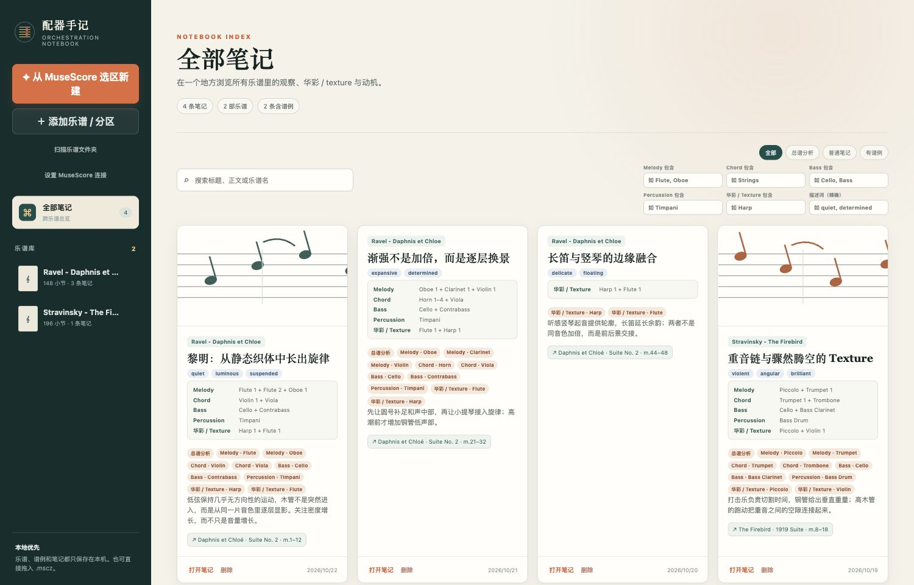
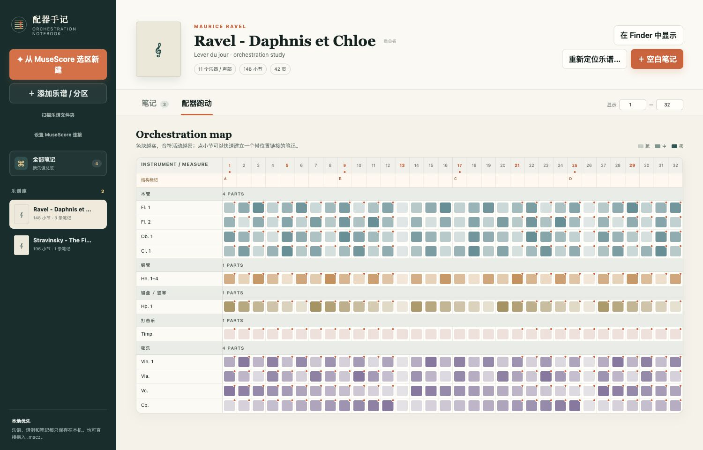
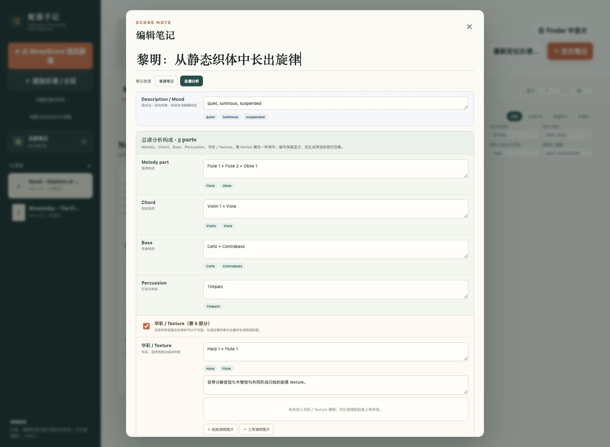

# 配器手记 Orchestra Notebook

一个面向配器学习的本地优先笔记 App。它把 Notion 式自由笔记、MuseScore 乐谱位置和配器分析模板放在同一个界面里。

你可以对一整段总谱建立笔记，记录 Melody、Chord、Bass、Percussion、华彩 / Texture，加入多个位置链接与谱例图片，再从笔记一键回到 MuseScore 的原小节。

> 当前版本：v0.8.1。macOS 版已实际使用与验证；Windows 版复用相同界面和资料库格式，已通过 GitHub Windows runner 编译、打包与文件检查，尚待更多 Windows 实机联动反馈。

## 直接下载

- [下载 macOS 版（最新版）](https://github.com/JonathanWry/orchestra-notebook/releases/latest/download/Orchestra-Notebook-macOS.zip)
- [下载 Windows x64 版（最新版）](https://github.com/JonathanWry/orchestra-notebook/releases/latest/download/Orchestra-Notebook-Windows-win-x64.zip)
- [查看全部版本与更新说明](https://github.com/JonathanWry/orchestra-notebook/releases)

下载后不需要克隆仓库或自己编译。Windows 压缩包必须完整解压后再运行；macOS 解压后把 App 拖入“应用程序”。

## 界面预览



| 32 小节配器跑动 | Notion 式总谱分析编辑器 |
| --- | --- |
|  |  |

截图使用内置匿名演示资料，不包含真实乐谱路径或个人笔记。演示数据生成器位于 [`docs/demo-data.js`](docs/demo-data.js)，界面更新后可以重复生成截图。

## 功能

- 像普通页面一样编辑标题、段落、二级标题、粗体、斜体、列表、引用和图片。
- 单条笔记可以保存多个乐谱位置，不要求为每件乐器分别记笔记。
- 总谱分析包含 Melody、Chord、Bass、Percussion、华彩 / Texture 五部分。
- 分别按五类配器角色中的乐器筛选；`Flute 1`、`Flute 2` 会保留原文，但筛选时归一为 `Flute`。
- Description / Mood 使用已有词精确搜索，例如 `quiet`、`determined`。
- 华彩 / Texture 可选择参与乐器，并加入多张谱例图片。
- “全部笔记”跨乐谱浏览与搜索，也可按乐谱文件名找到笔记。
- 乐谱移动后可手动重新定位，或扫描整个文件夹按唯一文件名自动修复。
- 导出当前笔记为自包含 Markdown 或 A4 PDF，保留字段、正文、链接与谱例。
- 自动读取 `.mscz` / `.mscx` 的乐器、乐器组、小节、排练标记、力度、密度和音域。
- 所有乐谱、笔记和图片只保存在本机，不上传到服务器。

## 支持平台

| 平台 | 状态 | 本地资料库 |
| --- | --- | --- |
| macOS 13+ | 已验证 | `~/Library/Application Support/Orchestra Notebook/library.json` |
| Windows 10/11 x64 | 兼容版、CI 构建 | `%APPDATA%\Orchestra Notebook\library.json` |

macOS 与 Windows 使用同一种 JSON 数据格式。由于笔记中的乐谱链接保存绝对路径，把资料库复制到另一台电脑后，请使用“扫描乐谱文件夹”重新定位乐谱。

## 下载与安装

### macOS

1. 从上方“直接下载”取得最新版，或在 macOS 上运行 `./build.sh`。
2. 解压后把“配器手记.app”拖入“应用程序”。
3. 第一次打开后点击“设置 MuseScore 连接”。

项目采用本地 ad-hoc 签名，没有 Apple Developer 公证。若 Gatekeeper 阻止打开，请在 Finder 中右键 App，选择“打开”。

### Windows

1. 从上方“直接下载”取得 Windows x64 最新版。
2. 解压到一个固定文件夹，运行 `OrchestraNotebook.exe`；无需安装 .NET Runtime。
3. Windows 10/11 通常已包含 Microsoft Edge WebView2 Runtime；如系统提示缺少，请安装微软官方 WebView2 Runtime。
4. 在 App 中点击“设置 MuseScore 连接”，重启 MuseScore Studio 后启用插件。

Windows 的详细说明见 [docs/WINDOWS.zh-CN.md](docs/WINDOWS.zh-CN.md)。

## 使用方法

### 从 MuseScore 选区新建笔记

1. 在 App 中点击“设置 MuseScore 连接”。
2. 完整退出并重新打开 MuseScore Studio，在插件管理器启用“配器手记：从选区新建笔记”。
3. 在 MuseScore 中横跨需要的声部，选择一个小节区间。
4. 运行“插件 → 配器手记：从选区新建笔记”。
5. App 会创建一条未保存笔记，并自动加入原文件与小节范围。

建议快捷键：

- macOS：`Control + Option + N`（`⌃⌥N`）
- Windows：`Ctrl + Alt + N`

不要使用 `⌘N` 或 `Ctrl+N`，它们通常属于 MuseScore 的“新建乐谱”。

### 加入华彩 / Texture 或谱例

打开笔记后勾选“加入华彩 / Texture”，填写参与乐器；可以连续粘贴或上传多张图片。这里既可记录独奏式华彩、装饰性跑动，也可记录持续音型、背景运动或织体层。普通正文中的“粘贴谱例”和“上传图片”则把图片插在正文光标处。

### 回到原谱

点击位置块或笔记卡片上的小节链接。App 会打开原 `.mscz/.mscx` 并尝试跳到对应小节；如果系统不允许自动输入，小节号仍会复制到剪贴板。

### 乐谱移动后重新定位

- 单部乐谱：进入乐谱页，点击“重新定位乐谱…”。
- 多部乐谱：点击左侧“扫描乐谱文件夹”，选择包含全部乐谱的大文件夹。只有文件名唯一匹配时才会自动修复；重名项目会跳过。

### 导出笔记

打开一条笔记，在底部选择“导出 .md”或“导出 PDF”。无需先保存，导出内容以当前编辑器中的状态为准。

## 从源码构建

### macOS

需要 Apple Command Line Tools：

```zsh
./build.sh
```

产物：

- `dist/配器手记.app`
- `dist/Orchestra-Notebook-macOS.zip`

解析器 smoke test：

```zsh
./dist/配器手记.app/Contents/MacOS/OrchestraNotebook --inspect /path/to/score.mscz
```

### Windows

需要 Windows、PowerShell 和 .NET 8 SDK：

```powershell
.\build-windows.ps1
```

产物：

- `dist\windows-win-x64\`
- `dist\Orchestra-Notebook-Windows-win-x64.zip`

Windows 宿主采用 WinForms + Microsoft Edge WebView2。WebView2 NuGet 包固定在 `1.0.4258.31`；应用发布为 self-contained，因此用户不需要另装 .NET。

## 项目结构

```text
Resources/                         共用界面、样式、JS 与 MuseScore 插件
Sources/main.m                     macOS AppKit / WKWebView 宿主
windows/OrchestraNotebook.Windows Windows WinForms / WebView2 宿主
Tools/                             macOS 图标生成工具
build.sh                           macOS 构建脚本
build-windows.ps1                  Windows 构建脚本
```

## 数据与隐私

资料库文件中包含笔记正文、谱例图片的 data URL、乐谱绝对路径和筛选字段。App 不联网，但这些内容可能包含你的私人路径，因此提交 issue 时不要直接上传真实 `library.json`；请先删除个人路径与笔记内容。

## 实现说明

- 原生层负责文件选择、乐谱解析、剪贴板、PDF 导出、MuseScore 插件安装和文件路由。
- HTML/CSS/JavaScript 界面由 macOS 与 Windows 共用。
- MuseScore 插件只写出当前 selection 的文件路径、小节与 staff 范围，不修改原谱，也不会自动渲染整个选区。
- macOS 使用 AppKit + WKWebView；Windows 使用 WinForms + WebView2。

## 已知边界

- 回跳的稳定锚点是小节号；自动排版页码可能随 MuseScore 布局变化。
- 插件记录 staff 范围，但回跳不会自动恢复 staff 选择高亮。
- Windows 自动跳转依赖 MuseScore 窗口能够获得前台焦点；失败时会退化为打开乐谱并复制小节号。
- Windows 版目前在 CI 中编译和打包，仍欢迎在不同 Windows 10/11 与 MuseScore 4 小版本上反馈实机结果。

## 参考与复用边界

- [MuseScore](https://github.com/musescore/MuseScore) 的插件 API 用于读取当前 selection。
- [OpenSheetMusicDisplay](https://github.com/opensheetmusicdisplay/opensheetmusicdisplay) 与 [Verovio](https://github.com/rism-digital/verovio) 都适合浏览器端渲染；本项目目前让 MuseScore 保持原始刻印与布局，因此未引入它们。
- Windows 宿主使用微软的 [WebView2](https://learn.microsoft.com/microsoft-edge/webview2/)；macOS 使用系统 WebKit。

## 贡献

欢迎提交 issue 与 pull request。请先阅读 [CONTRIBUTING.zh-CN.md](CONTRIBUTING.zh-CN.md)。

## License

[MIT](LICENSE)
